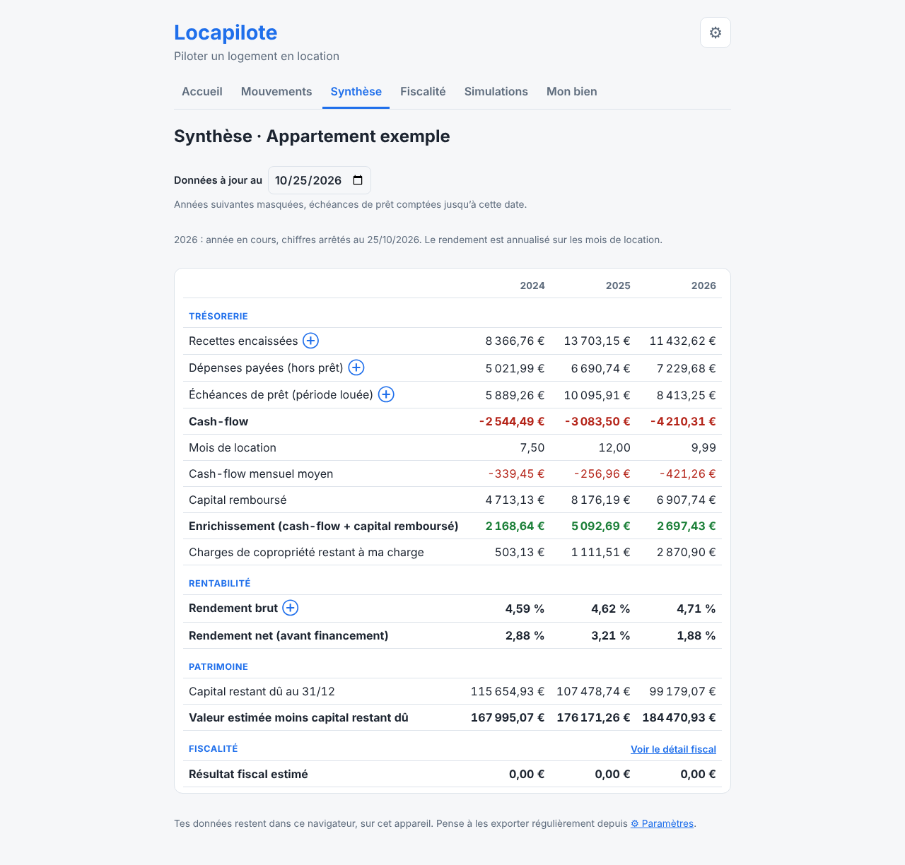

# Locapilote

**[Ouvrir l'application en ligne](https://locapilote.art-dindy.workers.dev)** : au premier lancement, choisir « Commencer avec le jeu de test » pour la découvrir avec des données d'exemple.

Locapilote aide un propriétaire à suivre un logement qu'il loue : il saisit une seule fois ses loyers et ses dépenses, et l'outil en tire le cash-flow, la rentabilité, le résultat fiscal et des simulations.
Je l'ai construit pour remplacer un fichier Excel de suivi locatif devenu difficile à faire évoluer, et pour apprendre à livrer un produit de bout en bout.
J'y tiens le rôle de product owner (cadrage, user stories, priorités, recette) ; [Claude Code](https://claude.com/claude-code) écrit le code et les tests.

## Où en est le projet

Projet personnel en cours de construction, MVP prévu en décembre 2026.

Déjà en ligne :

- Suivre un ou plusieurs biens, avec leur régime fiscal
- Saisir les opérations (loyers, charges, travaux) et charger le tableau d'amortissement du prêt
- Voir chaque année le cash-flow, l'enrichissement et les rendements
- Obtenir le récapitulatif fiscal en LMNP réel (charges, amortissements par composant, report) et le rapprocher des comptes du comptable
- Exporter et réimporter toutes ses données

À venir :

- Simuler une vente à plusieurs dates (somme nette, impôt sur la plus-value, rendement réel) et suivre un budget prévisionnel
- Un tableau de bord d'accueil, et donner l'outil à un proche

## La démarche

1. **Diagnostic** d'un Excel de suivi existant : structure, erreurs, synthèse chiffrée.
2. **Restructuration** de l'Excel : journal unique, référentiels, fiscalité LMNP réel, contrôles.
3. **Conception produit** : personas, 21 user stories, MVP, comparaison de cinq options techniques → [`docs/conception.md`](docs/conception.md).
4. **Construction** par itérations, chacune testée sur un jeu de test anonymisé et comparée à l'Excel de référence → [`docs/regles-de-calcul.md`](docs/regles-de-calcul.md).

## Technique

Application web sans serveur : Vite, React, TypeScript, stockage dans le navigateur (IndexedDB), tests Vitest (moteur) et Playwright (parcours sur ordinateur et téléphone), hébergement Cloudflare Workers (site statique). Le moteur de calcul est séparé des écrans : un socle commun et un module par régime fiscal.

## Données

`data/` contient un jeu de test anonymisé (noms, adresses et références remplacés, montants multipliés par un même coefficient) et les résultats attendus. Aucune donnée personnelle réelle n'est publiée.

Dans l'application, les données sont stockées dans le navigateur (IndexedDB) et ne quittent jamais l'appareil. L'application permet de tout exporter en JSON (et de le réimporter) et d'exporter les opérations en CSV pour Excel.

## Avertissement

Locapilote produit des estimations à des fins de suivi. Ce n'est pas un conseil fiscal : faites confirmer les règles par un expert-comptable ou sur impots.gouv.fr.

## Licence

MIT

## Développement

Prérequis : Node.js 22.

| Commande | Rôle |
| --- | --- |
| `npm install` | Installe les dépendances |
| `npm run dev` | Lance l'application en local |
| `npm test` | Lance les tests du moteur (Vitest) |
| `npm run test:e2e` | Lance les tests de parcours dans le navigateur (Playwright ; la première fois : `npx playwright install chromium`) |
| `npm run lint` | Vérifie le code (ESLint) |
| `npm run build` | Construit le site dans `dist/` |

Mise en ligne : Cloudflare Workers, qui sert le site statique construit dans `dist/` (voir `wrangler.jsonc`).

- Chaque fusion dans `main` est déployée automatiquement en production par Workers Builds, l'intégration Git de Cloudflare (build `npm run build`, déploiement `npx wrangler deploy`).
- Chaque branche a son propre aperçu : `https://<branche>-locapilote.art-dindy.workers.dev`.
- GitHub Actions (`.github/workflows/tests.yml`) lance les tests, le lint, le build et les tests de parcours à chaque pull request ; il ne déploie rien.
